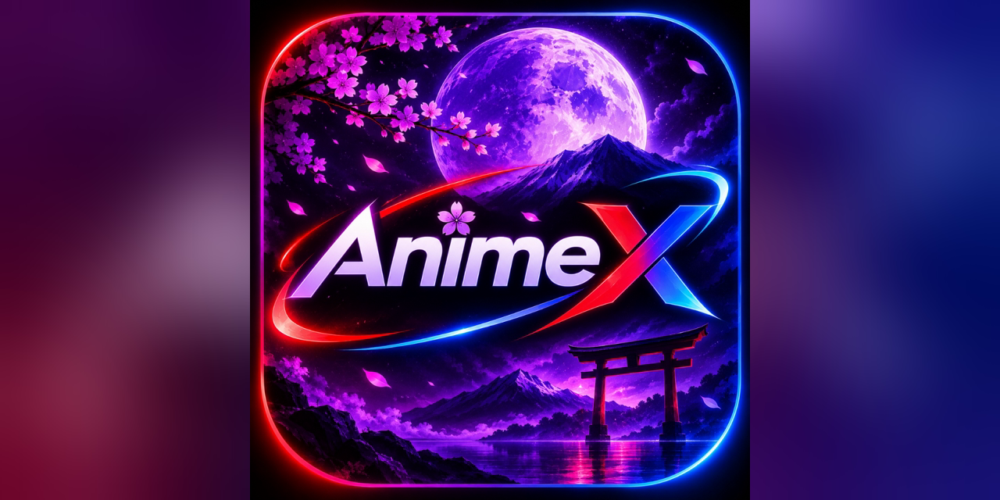
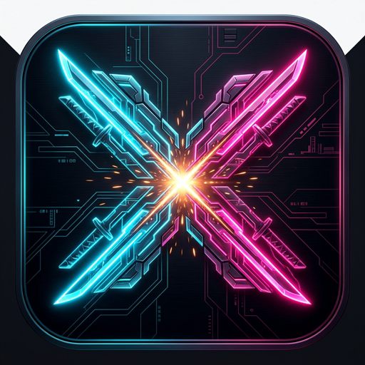

<div align="center">





# AnimeX

**Futuristic Native Android & Android TV Anime Streaming Client**

[](https://github.com/IIT2011/AnimeX/releases/latest)
[](https://github.com/IIT2011/AnimeX/releases/tag/AnimeX-V1.1)
[](https://github.com/IIT2011/AnimeX/releases/tag/AnimeX-tv-V1.0)
[](https://github.com/IIT2011/AnimeX)
[](https://kotlinlang.org)

</div>

---

AnimeX is a high-performance native Android & Android TV anime streaming client built with **Kotlin** and **Jetpack Compose**, featuring a **Cyber-HUD / Neo-Tokyo Minimalist** design system, a dedicated 10-foot D-pad Leanback experience for Android TVs, batch & individual HLS anime downloader, interactive comments, on-device personalized recommendation engine, real Google Cloud sync, and native offline playback.

---

## 📺 Dedicated Android TV Experience (`:tv`)

AnimeX now features a standalone, optimized **Android TV & Google TV** module (`tv/`) crafted specifically for 10-foot viewing and remote control (D-pad) navigation:

- **10-Foot Cyber-HUD UI:** Immersive 1080p/4K landscape UI with high-contrast neon focus states (1.08x scale-up, glowing cyan/magenta border transitions).
- **Dynamic Hero Billboard:** Top billboard dynamically updates backdrops, ratings, synopsis, and metadata as you navigate across shelves below.
- **Horizontal Content Shelves:** "Trending On AnimeX", "Recommended For You", "Latest Broadcasts", "Top Rated Airing", and "All-Time Popular".
- **Leanback TV Video Player:** Full D-pad remote mapping:
  - `OK / Center`: Play / Pause toggle with HUD auto-hide after 4 seconds.
  - `◀ / ▶`: Instant 10-second seek backward / forward with on-screen HUD badge.
  - `▲ Up`: In-player quick horizontal Episode Drawer (switch episodes without leaving playback).
  - `▼ Down`: Stream resolution (1080p / 720p / 480p) & audio selector.
- **On-Screen D-Pad Keypad & Search:** Grid keyboard designed for TV remote navigation with instant live search suggestions.
- **Android TV Launcher Integration:** Dedicated `LEANBACK_LAUNCHER` intent and 16:9 high-res TV banner (`tv_banner.png`).

---

## What's New in v1.1 ⚡

1. **📥 Batch & Individual Anime Downloader:**
   - **External Downloads:** Saves directly to Android storage at `Downloads/AnimeX/<Anime Name>/<Anime Name S1 EP#>.mp4`.
   - **In-App Downloads:** Saves inside AnimeX for full offline viewing directly from your profile.
   - **Stream Configurator:** Customizable Video Quality (1080p, 720p, 360p), Audio (Sub/Dub), and Subtitles before starting.
   - **Batch Episode Selector:** Download entire seasons or select individual episodes with 1 tap.

2. **💬 Interactive Anime Transmissions (Comments):**
   - Live community commenting on any anime title with timestamping, custom avatars, and like counter.
   - Comments persist locally and survive application restarts.

3. **👤 Profile Alias Customizer & Real-time Availability Check:**
   - Customize your user handle directly from your Profile card.
   - Real-time availability verification checks for reserved or taken usernames before claiming.

4. **📂 Fullscreen Expandable Watchlists & Downloads Manager:**
   - **"Watchlists":** 1-tap expansion from profile covering the full screen with comprehensive 2-column grid and quick play.
   - **"Downloads":** Complete storage manager showing anime groupings, episode counts, disk space used, and 1-tap offline ExoPlayer playback.

---

## Architecture Overview

```
animex/
├── app/                              # Mobile Android Application (Phone & Tablet)
│   ├── src/main/
│   │   ├── AndroidManifest.xml
│   │   └── java/com/animex/app/
│   │       ├── MainActivity.kt       # Edge-to-edge Compose host
│   │       ├── AnimeXApp.kt          # Application base & repository bootstrapper
│   │       ├── core/                 # Design system, network, download, comment & sync
│   │       ├── feature/              # Home, genre, schedule, detail, player, search & account
│   │       └── navigation/           # Compose Navigation graph
│   └── build.gradle.kts
├── tv/                               # Android TV / Google TV 10-Foot Application
│   ├── src/main/
│   │   ├── AndroidManifest.xml       # Leanback launcher & TV features
│   │   ├── java/com/animex/tv/
│   │   │   ├── TVMainActivity.kt     # D-pad remote navigation & leanback host
│   │   │   ├── AnimeXTVApp.kt        # TV application base
│   │   │   ├── theme/TVTheme.kt      # Cyber TV OLED theme & remote focus modifiers
│   │   │   ├── components/           # TVTopNav, TVCard, TVHeroBillboard, TVEpisodeCard
│   │   │   ├── ui/home/              # Dynamic billboard & horizontal content shelves
│   │   │   ├── ui/detail/            # 16:9 split detail view & episode carousel
│   │   │   ├── ui/player/            # 10-foot remote ExoPlayer (Seek, Up/Down drawers)
│   │   │   ├── ui/search/            # D-pad virtual keyboard & live search grid
│   │   │   ├── ui/genre/             # TV genre pills & archive browser
│   │   │   ├── ui/schedule/          # Broadcast schedule tracker
│   │   │   └── ui/watchlist/         # Saved watchlist grid
│   │   └── res/drawable/tv_banner.png# 16:9 Leanback banner for Android TV home
│   └── build.gradle.kts
├── gradle/
│   └── libs.versions.toml            # Version catalog (Compose, Media3, Coil, Kotlinx)
├── build.gradle.kts
└── settings.gradle.kts
```

---

## Key Features

1. **Cyber-HUD Design System:**
   - **Void Black (`#07080D`) & Obsidian Surfaces:** True OLED blacks optimized for AMOLED displays.
   - **Neon Accents:** Electric Cyan (`#00F0FF`), Neon Magenta (`#FF007F`), and Amber.
   - **Cyber Modifiers:** Animated glowing scanlines, pulse borders, and tactile click micro-animations.

2. **Native HLS & Offline Video Engine:**
   - Powered by **Jetpack Media3 (ExoPlayer)**.
   - Supports online HLS streams with anti-leech referer injection and offline playback for in-app downloads.
   - YouTube-style double-tap seeking ($\pm 10$s, $\pm 20$s, $\pm 30$s looping with hidden controls during seeking).
   - Sensor-based landscape orientation locking, resolution switcher (1080p / 720p / 360p), multi-language subtitle tracks, and audio switcher.

3. **On-Device Personalized Recommendations:**
   - Learns dynamically from genres watched, search queries, and watch completion percentages.
   - Produces fine-grained affinity match scores (`95% MATCH`, `88% MATCH`).
   - Persists intelligence locally in internal sandbox storage (`.animex_user_intel.txt`).

4. **Google Cloud AppData Sync:**
   - Seamless 1-tap device account connection, native Android account picker, and direct email binding.
   - Automatically synchronizes watchlist entries, episode playback progress, and user preferences into your private Google space (`.animex_google_sync.txt`).

5. **Airing Timings & Schedule Tracker:**
   - Day-by-day broadcast timeline showing episode drop times (`18:30`, `00:30`, etc.).

---

## How to Build & Run

1. Clone the repository:
   ```bash
   git clone https://github.com/IIT2011/AnimeX.git
   ```
2. Open the project folder in **Android Studio** (Koala, Ladybug, or newer).
3. Connect an Android phone, tablet, or Android TV device / emulator (API 26+).
4. Select the target run configuration:
   - **`app`**: Mobile & tablet Android application
   - **`tv`**: 10-foot Android TV & Google TV application
5. Click **Run ▶** (`Shift + F10`) or assemble via CLI:
   ```bash
   ./gradlew :app:assembleRelease   # Generates mobile APK
   ./gradlew :tv:assembleRelease    # Generates Android TV APK
   ```
